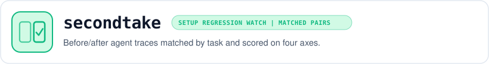

# Secondtake Documentation

  <picture>
    <source media="(prefers-color-scheme: dark)" srcset="media/lockup-dark.svg">
    
  </picture>

Welcome to the documentation suite for `secondtake`, the matched-pair regression watch for AI agent setup changes (`AGENTS.md` edits, prompt changes, model switches, harness upgrades).

## Documentation Index

| Document | Audience | Contents |
| :--- | :--- | :--- |
| [Operator & Integrator Guide](GUIDE.md) | Prompt & eval engineers | Installation, `compare` CLI, registration schema, Canonical Form 1 task-key pairing, JEV live/replay judge |
| [Technical Architecture](ARCHITECTURE.md) | Systems engineers & contributors | Four-axis behavioral scoring, margin bands, one-regression decision card, write-isolation guard |
| [Wire Formats & Schemas](FORMATS.md) | Integrators & CI authors | `registration.json`, `judgments.json`, `comparison.json` field contracts, exit codes `0`/`1`/`2` |
| [Ecosystem Comparison](COMPARISON.md) | Evaluators & leads | How `secondtake` differs from ad-hoc vibe evals, Promptfoo/Braintrust, and `flighttape compare` |
| [Performance & Scale](PERFORMANCE.md) | Infrastructure teams | Measured benchmarks up to `500` tapes / `250` matched pairs (`87.32 ms`, `5,726` tapes/sec) |
| [Frequently Asked Questions](FAQ.md) | All users | Pre-registration rationale, `ambiguous` vs `unmatched` pairs, `JEV_CALL` live protocol, `flighttape` dependency |
| [Storefront README Draft](STOREFRONT_README_DRAFT.md) | Maintainers & Muse seat | Drop-in visual storefront upgrade aligned with Round 45 (`45 of 100`) |

## Machine-Readable Contracts

- Schemas: [`../schema/registration.schema.json`](../schema/registration.schema.json), [`../schema/judgments.schema.json`](../schema/judgments.schema.json), [`../schema/comparison.schema.json`](../schema/comparison.schema.json)
- Runnable Examples: [`../examples/before/`](../examples/before/), [`../examples/after/`](../examples/after/), [`../examples/registration.json`](../examples/registration.json), [`../examples/jev_call_example.py`](../examples/jev_call_example.py)

## Distribution, Containers, Manual Page, and Reproducible Benchmarks

- **Unix Installer**: [`../install.sh`](../install.sh) (`curl -fsSL https://raw.githubusercontent.com/david-engelmann/secondtake/main/install.sh | sh`)
- **Windows PowerShell Installer**: [`../install.ps1`](../install.ps1) (`irm https://raw.githubusercontent.com/david-engelmann/secondtake/main/install.ps1 | iex`)
- **Manual Page**: [`../man/secondtake.1`](../man/secondtake.1) (`man ./man/secondtake.1`)
- **Container Image**: [`../Dockerfile`](../Dockerfile) (`docker build -t secondtake:local .`)
- **Reproducible Scale Benchmark**: [`../scripts/bench.py`](../scripts/bench.py) (`python3 scripts/bench.py`)
